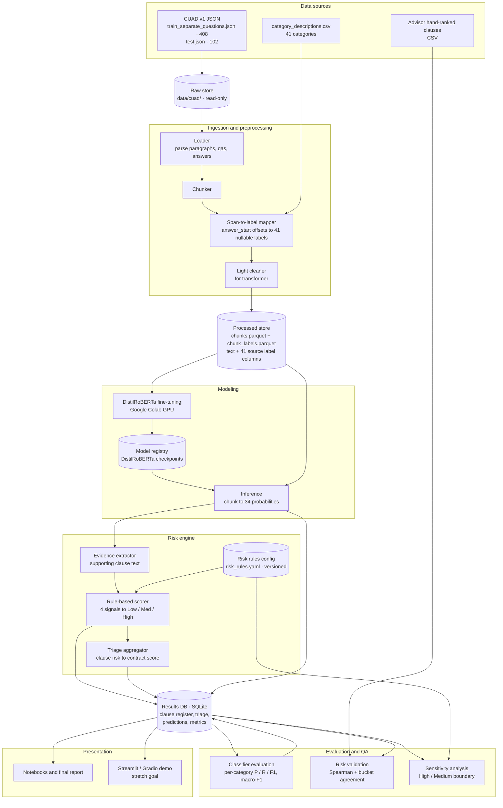
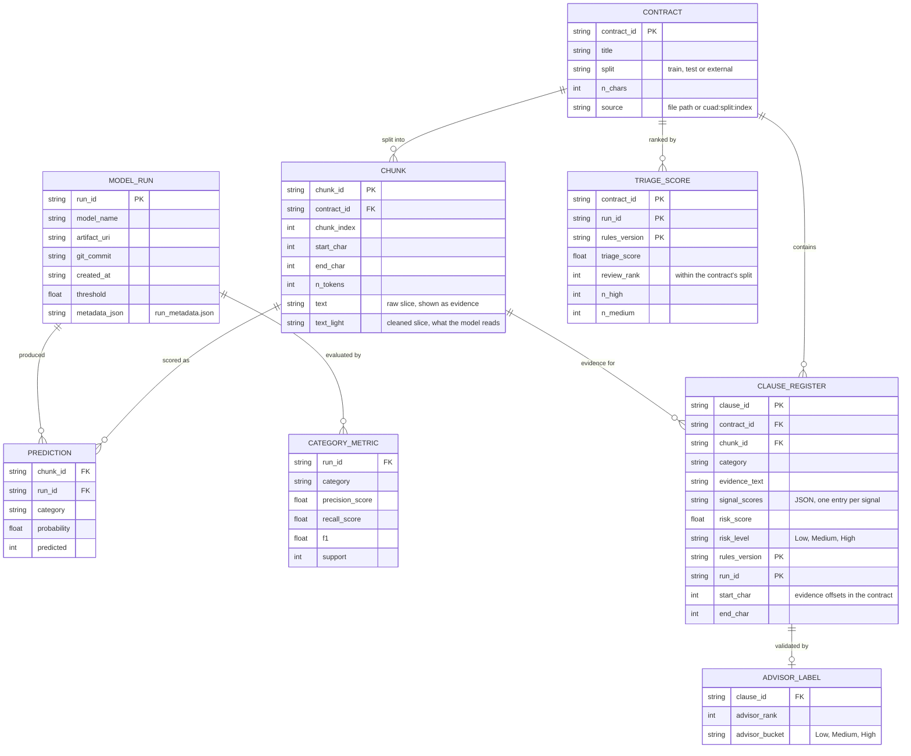

# System Architecture: CUAD Contract Review Pipeline

**Accenture AI Studio Challenge · Break Through Tech AI Studio, Fall 2026**

> **Status:** living document. Items marked **Frozen** are decisions the team has already locked. Items marked **Proposed** are suggestions to confirm with the team before building.

---

## 1. Context and goals

Legal and procurement teams review tens of thousands of contracts a year, but only a small number of clauses in each carry real risk. This system reads a contract, detects selected CUAD clause categories, assigns each detected clause a Low / Medium / High risk level using explainable rules, and rolls those up into a contract-level triage score so reviewers know which contracts to open first. The current transformer scope is 34 of CUAD's 41 categories: categories without positive training labels are excluded from model outputs.

Design priorities, in order:

1. **Auditability.** Every risk score must trace back to the clause text, the model run, and the rule version that produced it.
2. **Reproducibility.** Any result in the final report can be regenerated from the repo, the config, and a recorded model run.
3. **Simplicity.** A five-person student team on Colab, so no servers to maintain.

---

## 2. High-level architecture

Cylinders are persistent stores. Rectangles are processing components.



---

## 3. Results database schema

The Results DB is the single source of truth for everything downstream of the classifier. Chunk labels for training live in the Parquet file. The DB holds what the system *produces*.

**Status: implemented (#46)** in `src/db/schema.py`, written by `src/pipeline.py`. How to run it and query it: [PIPELINE.md](PIPELINE.md).



**Why `run_id` and `rules_version` appear everywhere:** they are what make a risk score auditable. Any row in the clause register can answer "which model flagged this, and which version of the rules scored it?"

What the implementation (#46) added to the original design, and why:

* **`run_id` and `rules_version` are part of the key** of `CLAUSE_REGISTER` and `TRIAGE_SCORE`. Re-scoring with a new rules version, or a new checkpoint, adds rows instead of overwriting the old scores, so versions can be compared.
* **`run_id` is derived from the checkpoint files**: run folder name plus a hash of `run_metadata.json` and `classifier.pt` (`src/db/runs.py`). The trainer does not record a run id, commit or timestamp. Hashing gives the same id on every machine, and a new id for every retrain. `git_commit` is the commit of the code that ran the pipeline.
* **`CLAUSE_REGISTER` keeps the evidence offsets** (`start_char`, `end_char`), which index the original contract text, so a reviewer can find the source wording.
* **`CHUNK` keeps the raw text as well as the cleaned text.** The light cleaner never changes length, so one set of offsets indexes both. Evidence is shown in the original wording.
* **`MODEL_RUN` records the threshold**, since `PREDICTION.predicted` depends on it.
* **`review_rank` is computed within a split** (test, train, external), so a train contract the model has already seen never outranks unseen test contracts.

---

## 4. Components

| Component | Layer | Input | Output | Status |
|---|---|---|---|---|
| Loader | Preprocessing | Raw CUAD JSON or a `.txt` file | Contract text + answer spans | Frozen (official split, no PDF parsing yet: #53) |
| Chunker | Preprocessing | Contract text | Chunks with character offsets | Frozen (510 tokens, 128 overlap; decided in #22, built in #23) |
| Span-to-label mapper | Preprocessing | Chunks + `answer_start` spans | 41 nullable labels per chunk | Frozen; 7 train-excluded categories remain missing in train labels |
| Light cleaner | Preprocessing | Labeled chunks | Cleaned text column | Frozen (applied after mapping) |
| DistilRoBERTa trainer | Modeling | Light-cleaned text + 34 train-supported labels | Fine-tuned checkpoint | Frozen model choice and category scope; imbalance strategy TBD |
| Inference | Modeling | Chunks + checkpoint | 34 probabilities per chunk | Built (`src/models/predict.py`, #43) |
| Evidence extractor | Risk engine | Predictions | Supporting clause text per category | Built (`src/risk/evidence.py`, #9) |
| Rule-based scorer | Risk engine | Evidence + `risk_rules.yaml` | Risk level per clause | Built (`src/risk/scorer.py`, #9); rules version still draft |
| Triage aggregator | Risk engine | Clause risk levels | Contract triage score + rank | Built (`src/risk/triage.py`, #9); ranked within each split |
| Results DB | Storage | Stage outputs | SQLite tables of §3 | Built (`src/db/`, #46) |
| Pipeline | Orchestration | Contract files or CUAD contracts | DB rows, stage by stage | Built (`src/pipeline.py`, #46) |
| Report generator | Presentation | Results DB | TXT + JSON report per contract, with review flags | Built (`src/report.py`); page/line numbers pending #54/#55, LLM overview pending #56 |
| Amount normalizer | Presentation | Evidence text | Money amounts as one value (`$1M` = `$1,000,000`) | Built (`src/risk/amounts.py`); listed in reports, not used in scoring |
| Classifier evaluation | Evaluation | Predictions + gold labels | Per-category metrics | Frozen metric (macro-F1) |
| Risk validation | Evaluation | Clause register + advisor CSV | Spearman, bucket agreement | Proposed |
| Sensitivity analysis | Evaluation | Rules config + DB | Boundary stability report | Proposed |

---

## 5. Storage choices

| Store | Technology | Contents | Why this choice | Status |
|---|---|---|---|---|
| Raw store | Files in `data/cuad/` | Official CUAD JSON + category CSV | Never modified, so preprocessing is always rerunnable | Frozen |
| Processed store | Parquet | One row per chunk: ids, offsets, original/light-cleaned text, 41 nullable source label columns | Keeps source annotations intact; the model selects 34 categories with positive training examples | Proposed |
| Model registry | Shared Google Drive folder (or Hugging Face Hub) | DistilRoBERTa checkpoints | Colab disks reset every session; checkpoints are too large for git | Proposed |
| Risk rules config | YAML in git | Signal weights, thresholds, category risk tiers | Rules are reviewable in pull requests, and every change gets a version | Proposed |
| Results DB | SQLite file | Clause register, triage scores, predictions, metrics, advisor labels | Single file, no server, queryable with SQL, easy to hand to the advisor | Built (#46) |

**Trade-off note.** SQLite is the right size for 510 contracts. It would need to become Postgres only if the system served many concurrent users, which is outside this project's scope.

---

## 6. Runtime environments

| Environment | Used for |
|---|---|
| Google Colab (GPU) | DistilRoBERTa fine-tuning and batch inference |
| VS Code / Jupyter (local) | Preprocessing, risk engine, EDA, error analysis |
| GitHub | Code, configs, docs, GitHub Projects board |
| Shared Google Drive | Model checkpoints and large processed files |

---

## 7. Key decisions and trade-offs

**Frozen**

- **Official train/test split, no re-splitting.** Keeps the split at the contract level to prevent leakage and keeps results comparable to the CUAD paper.
- **Cleaning runs after span-to-label mapping.** The light cleaner preserves character length by blanking known artifacts with spaces, so source offsets remain aligned; applying it after mapping also keeps annotation logic anchored to the original CUAD text.
- **No TF-IDF baseline.** The advisor asked us to go straight to the transformer (October 2026). The comparison point is the naive "predict absent for everything" baseline from the EDA: 67.4% accuracy, 0% recall.
- **34-category transformer scope.** Keep all 41 categories in the span-label artifact, but train and evaluate model outputs only for the 34 categories with positive training labels. The other 7 stay nullable in the training labels and are outside the classifier's output scope.
- **One cleaning function.** Only the transformer reads the text, and it needs text close to the original. The heavier cleaner existed only for TF-IDF and has been dropped.
- **Chunking: sliding token windows, 510 tokens with 128 overlap.** 510 is DistilRoBERTa's 512-token limit minus its 2 special tokens. Keeps 97.8% of annotated clauses whole on train. The strategy was chosen for the transformer's tokenizer, so dropping the baseline does not affect it.
- **Macro-F1 as the headline metric.** CUAD is heavily imbalanced, so accuracy is misleading.
- **Rule-based risk scoring.** No ground-truth risk labels exist, and explainability matters more than raw capability here.

**Known data caveats to carry through every report**

- Price Restriction has no examples in the official test set.
- The dataset contains slightly more annotations than the CUAD paper reports.

---

## 8. Repo layout

**Status: implemented.** The directory tree below exists in the repo.

```
Accenture-1Q-contract-review-challenge/
├── data/
│   ├── cuad/                 # raw store (read-only)
│   └── processed/            # chunks.parquet (gitignored if large)
├── configs/
│   └── risk_rules.yaml       # versioned risk rules
├── src/
│   ├── ingest/               # loader, chunker, span-to-label mapper
│   ├── clean/                # light cleaner
│   ├── models/               # DistilRoBERTa train / infer
│   ├── risk/                 # evidence extractor, scorer, triage, amount normalizer
│   ├── db/                   # SQLite schema, read/write helpers, run ids
│   ├── eval/                 # metrics, Spearman, sensitivity
│   ├── pipeline.py           # ingest -> infer -> score, into the results DB
│   ├── report.py             # TXT / JSON review report per contract
│   └── demo.py               # one contract, printed to the terminal, no DB
├── notebooks/                # EDA, error analysis
├── models/                   # trained run folders from Drive (gitignored)
├── results/
│   ├── cuad_results.db       # results DB (gitignored)
│   └── reports/              # generated contract reports (gitignored: quote contract text)
├── app/                      # Streamlit / Gradio demo (stretch)
├── reports/                  # final report, figures
├── tests/                    # pytest; no checkpoint or GPU needed
└── docs/
    ├── ARCHITECTURE.md       # this file
    └── PIPELINE.md           # how to run the pipeline and reports
```

What `.gitignore` keeps out: `data/processed/*.parquet`, `results/*.db`,
`results/reports/`, `/models/` and model checkpoints (`*.pt`, `*.bin`,
`*.safetensors`, `*.pkl`), confidential `contracts/`, `__pycache__/`, and
`.ipynb_checkpoints/`. Everything ignored is regenerable from `data/cuad/` plus
committed code and configs.

`data/cuad/` is committed as-is (about 98 MB) so the team shares one fixed copy
of the official split. `data/processed/contract_categories.jsonl` is committed
too, at 9 MB; if processed artifacts grow, move them to shared Drive rather than
letting the repo balloon.

---

## 9. Open questions for the team

1. Where do model checkpoints live: shared Google Drive or a private Hugging Face Hub repo?
2. What are the four risk signals, and which ones depend on model confidence versus fixed category tiers?
3. What format will the advisor's hand-ranked clauses arrive in, and how do we match them to `clause_id`?
4. How do we handle class imbalance in DistilRoBERTa training: weighted loss, resampling, or per-category thresholds?
5. How should reports describe the seven CUAD categories outside the 34-category model scope?
