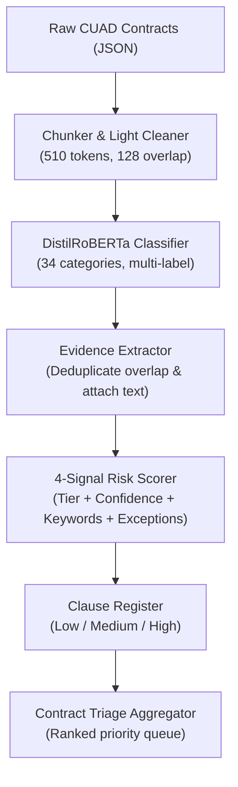

# End-to-End Project Overview: Automated Contract Review & Risk Triage

**Accenture AI Studio Challenge · Break Through Tech AI Studio, Fall 2026**

---

## 1. Executive Summary & The Problem

Legal and procurement teams at large organizations review tens of thousands of commercial agreements every year. Most of the language in these contracts is routine boilerplate, but a tiny fraction of clauses carry significant business and financial exposure (such as unlimited liability, restrictive non-competes, or harsh automatic renewals). 

Manually reviewing every single page is slow, expensive, and creates severe operational bottlenecks.

**Our Goal:** Build an automated, auditable contract review system that:
1. **Reads** raw commercial contracts.
2. **Finds** specific clause types across the document.
3. **Rates** each detected clause as **Low**, **Medium**, or **High** risk using explainable rules.
4. **Triages** entire contracts so legal teams immediately know which documents to open and review first.

```
Raw Contracts ──► Preprocessing & Chunking ──► AI Clause Detection ──► Evidence & Risk Scoring ──► Contract Triage
```

---

## 2. Preparing the Data (CUAD)

We used the **CUAD (Contract Understanding Atticus Dataset)**, a benchmark dataset of 510 real-world commercial contracts annotated by legal experts across 41 clause categories.

### A. Preserving the Official Split
To ensure our evaluation was fair and directly comparable to academic research, we kept the official dataset split:
* **408 Training Contracts**
* **102 Held-Out Test Contracts**

Crucially, the split was made at the **contract level**, not the paragraph level. This prevented "data leakage"—making sure the model was never tested on parts of a contract it had already seen during training.

### B. Cleaning the Text Without Breaking Offsets ("Light Cleaning")
Legal annotations in CUAD use exact character positions (start and end characters) to mark where clauses begin and end. 

Contract text often contains noise from scanning or filing systems—such as court docket headers, "Page X of Y" counters, and document source stamps. Normally, cleaning text involves deleting noise, collapsing spaces, or lowercasing words. However, deleting characters would shift all the character positions and misalign the human annotations.

* **Our Solution:** A custom **Light Cleaner** ([`src/clean/light.py`](../src/clean/light.py)). Instead of deleting noise, it replaces unwanted artifacts (like docket lines or page numbers) with an equivalent number of ordinary blank spaces. 
* This removed distracting noise for the model while keeping every single character offset perfectly intact.

---

## 3. The Chunking Strategy

### Why We Had to Slice Contracts
A typical commercial contract is 20 to 50+ pages long (15,000 to 40,000+ words). Modern transformer language models cannot read an entire contract at once; they have a strict physical limit on how much text they can process in a single pass (typically 512 tokens, or about 400 words).

To solve this, we divided each contract into smaller sections called **chunks**.

### Why 510 Tokens? (The ~500 Token Chunk Length)
The decision to set chunk size to **510 tokens** (often referred to as ~500 tokens) was driven by three key factors:

1. **Hardware & Architecture Limits (DistilRoBERTa's 512-Token Cap):**
   * Pretrained transformer models in the RoBERTa family have a hard maximum input length of **512 tokens**.
   * The model automatically inserts **2 mandatory special framing tokens**: `<s>` at the very beginning (used to represent the entire chunk) and `</s>` at the very end.
   * Subtracting these 2 special tokens leaves exactly **510 usable tokens** ($512 - 2 = 510$) for actual contract text. If we had fed 512 words of text, the model would either crash or silently truncate the end of the text—potentially throwing away a critical positive clause.
2. **Maximizing Legal Context per Step:**
   * Legal clauses are complex: they often start with an obligation, follow with exceptions, and finish with definitions. 
   * If chunks were smaller (e.g., 128 or 256 tokens), longer clauses like multi-sentence indemnification agreements would be chopped in half, robbing the model of the surrounding context needed to classify them accurately. 
   * Using 510 tokens maximizes the amount of continuous context the model can evaluate in each forward pass.
3. **Capturing Clause Distributions:**
   * Exploratory analysis of the CUAD dataset showed that the vast majority of legal clauses are under 300–400 tokens long. A ~500-token window easily encompasses almost all complete clause instances in their entirety.
4. **Computational Efficiency:**
   * A 30-page contract chopped into 128-token pieces would create hundreds of tiny chunks per document, multiplying GPU training time and memory requirements. 510-token chunks struck the optimal balance between computational speed and high detection accuracy.

### The Sliding Window: 510 Tokens + 128 Overlap
* **Chunk Size:** Each chunk contains at most **510 tokens** of text (roughly one standard page), matching the model's exact maximum capacity.
* **Overlap:** If we simply cut the text every 510 tokens, a crucial clause might get sliced right down the middle across a boundary. To prevent this, each chunk overlaps with the previous chunk by **128 tokens** (about 100 words). 
* This overlap ensures that **97.8% of annotated legal clauses remain completely intact** within at least one chunk.

```
Contract Text: [==================================================]
Chunk 1:       [-------------------]
Chunk 2:                 [-------------------]  <-- 128-token overlap
Chunk 3:                           [-------------------]
```

### Mapping Annotations to Chunks
Using the original character offsets, our pipeline mapped the human annotations into each chunk. If an expert marked a *Non-Compete* clause inside the text of Chunk 2, Chunk 2 received a positive training label for *Non-Compete*.

---

## 4. The Model: DistilRoBERTa Multi-Label Classifier

### Why DistilRoBERTa?
Instead of relying solely on keyword search (which fails when contracts use synonyms or uncommon phrasing), we used **DistilRoBERTa**, a lightweight and fast transformer neural network. It understands words in context—for example, distinguishing between a routine business obligation and a restrictive covenant.

### Scope: 34 Modeled Categories
While CUAD defines 41 categories, 7 categories in the training set had zero positive examples (or were extremely sparse). We configured the model to focus on the **34 categories** with sufficient training data, ensuring the model was only trained on patterns it could reliably learn.

### Multi-Label Classification (Sigmoid)
In standard classification (like sentiment analysis), an input is either positive *or* negative. In contract review, a single chunk can contain **multiple clauses at once** (e.g., both *Governing Law* and *Termination Notice* on the same page), or **no clauses at all**.
* Rather than forcing categories to compete against each other, the model outputs **34 independent probabilities** (from 0% to 100%), evaluating each category on its own merits using a sigmoid activation function.

### Masked Loss for Fair Training
Categories that were outside the training scope were masked out of the loss calculation. This prevented the model from falsely assuming that unannotated clauses were negative examples.

### Why Macro-F1 Over Accuracy
In legal datasets, clauses are rare needles in a haystack. Over 90% of contract chunks contain no special clauses. If a model simply predicted "No clauses present" for everything, it would achieve ~67% accuracy while being completely useless. 
* We evaluated the model using **Macro-F1** (balancing Precision and Recall equally across all categories), ensuring rare but critical categories received equal importance to common ones.

---

## 5. Explainable Risk Scoring Engine

A major requirement from legal advisors is **explainability**: a machine learning score alone is not enough; lawyers need to know *why* a clause is risky. 

Rather than using an unexplainable "black-box" model for risk, we built a modular, rule-based risk engine ([`configs/risk_rules.yaml`](../configs/risk_rules.yaml) & [`src/risk/scorer.py`](../src/risk/scorer.py)).

### Step 1: Evidence Extraction & Deduplication
Because chunks overlap by 128 tokens, a single clause often appears in two neighboring chunks. 
* [`src/risk/evidence.py`](../src/risk/evidence.py) takes all model predictions and selects the **single highest-probability chunk** per contract and category.
* It attaches the exact supporting text and character offsets, providing an auditable evidence package for human review.

### Step 2: The Four Risk Signals
For every detected clause, the engine calculates a composite risk score between 0.0 and 1.0 based on four weighted signals:

| Signal | Weight | What It Measures |
| :--- | :--- | :--- |
| **1. Category Inherent Tier** | **40%** | The baseline danger of the clause type (e.g., *Uncapped Liability* is inherently High risk; *Governing Law* is Low risk). |
| **2. Model Confidence** | **20%** | The classifier's probability. If the model is uncertain about a detection, the risk score is dampened to avoid false alarms. |
| **3. Restrictive Keywords** | **20%** | Checks for aggressive or one-sided phrasing in the text (e.g., *"sole discretion"*, *"without cause"*, *"perpetual"*, *"indemnify"*). |
| **4. Missing Protective Exception** | **20%** | Checks if the contract lacks a balancing protection elsewhere (e.g., an *Uncapped Liability* clause is doubly risky if the contract lacks a *Cap On Liability* clause). |

$$\text{Risk Score} = 0.40 \cdot S_{\text{tier}} + 0.20 \cdot S_{\text{conf}} + 0.20 \cdot S_{\text{keyword}} + 0.20 \cdot S_{\text{missing\_exception}}$$

### Step 3: Risk Level Mapping
The continuous score maps to three human-readable levels:
* **High ($\ge 0.70$)**
* **Medium ($\ge 0.35$)**
* **Low ($< 0.35$)**

> **Key Design Safeguard:** A high-tier category alone cannot reach "High" risk ($0.40 \times 1.0 + 0.20 \times 1.0 = 0.60$, which is Medium). A clause **must have an accompanying red flag** (an aggressive keyword or a missing protective exception) to be elevated to High risk.

---

## 6. Contract Triage: Prioritizing the Queue

Once all clauses in a contract are scored, [`src/risk/triage.py`](../src/risk/triage.py) rolls them up into a single contract-level review score:

$$\text{Triage Score} = 3 \times (\text{Number of High Clauses}) + 1 \times (\text{Number of Medium Clauses})$$

### The "Must-Review" Rule
To ensure critical risks are never buried under a high volume of minor issues:
* **Any contract with 2 or more High-risk clauses is automatically escalated to the top of the review queue**, regardless of its total score.
* Contracts with no detected risks receive a score of 0 and appear at the bottom.

Reviewers receive a sorted priority list showing exactly which contracts need urgent attention, which clauses triggered the alert, and the exact text snippets to inspect.

---

## 7. System Architecture at a Glance



---

## 8. Summary of Components & Directory Map

* [`data/cuad/`](../data/cuad/): Read-only store of the official CUAD dataset.
* [`src/ingest/`](../src/ingest/): Scripts for loading, chunking, and mapping human labels to text windows.
* [`src/clean/`](../src/clean/): Length-preserving text cleaner.
* [`src/models/`](../src/models/): DistilRoBERTa model definition, training loop, and tokenization.
* [`configs/risk_rules.yaml`](../configs/risk_rules.yaml): Versioned configuration for risk tiers, weights, and keywords.
* [`src/risk/`](../src/risk/): Evidence deduplication, 4-signal scoring, and contract triage.
* [`tests/`](../tests/): Automated test suite verifying chunking, evidence extraction, and risk scoring logic.
* [`reports/`](../reports/): Evaluation metrics and summary tables.
